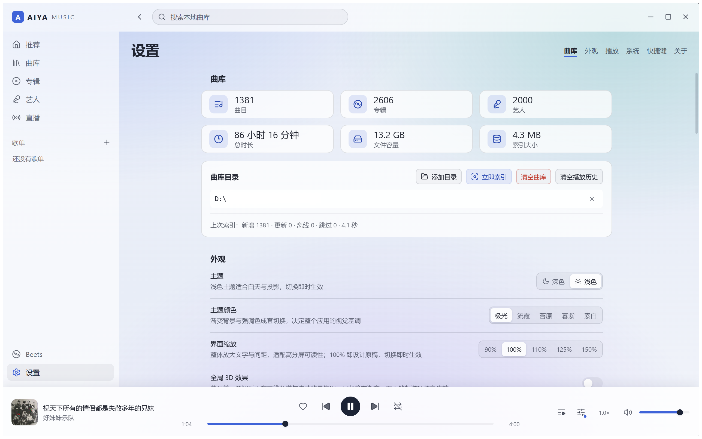

# AIYA Music

Windows 桌面本地音乐播放器：Rust 原生音频引擎、自有曲库索引、可选 [beets](https://beets.io) 集成。
以 GPL-3.0-or-later 开源。

| 曲库 + 均衡器 | 正在播放 | 设置 |
|---|---|---|
|  |  |  |

> 截图来自开发版界面。

## 特性

- **本地曲库**：SQLite 自有索引，目录扫描入库、增量刷新；在其他软件里改了标签或挪了文件，半分钟内列表自动跟上（默认 30 秒一轮，窗口失焦暂停，间隔可调或关闭）。5 万首曲库规模有性能基准覆盖（`npm run bench:50k`）。
- **音频引擎**：Symphonia 解码 + WASAPI 共享/独占输出，按源采样率开流，独占模式 bit-perfect；解码、DSP、设备、时钟全部在独立音频进程，播放不随窗口重载或崩溃中断。
- **播放与系统集成**：队列、随机、重复、播放位置恢复；系统媒体键（SMTC）、托盘、关窗控制同一状态机。
- **可视化与声音调节**：引擎链内频谱 tap（动画级 48 分带，关闭时零开销，不破坏 bit-perfect）、均衡器、播放速度。
- **直播**：HLS（m3u8）直播流与本地播放列表，地址去重的最近打开记录。
- **beets 集成（可选）**：曲库导入、整理、维护走 beets，两侧以冻结的协议 v1 通信；没装 beets 也完整可用（由编译期边界检查保证）。
- **轻量分发**：安装包个位数 MB、不含捆绑运行时；另提供免安装便携版（数据随目录走）。

## 下载

从 [GitHub Releases](https://github.com/yeraph-plus/aiya-music-player/releases/latest) 获取：

| 文件 | 说明 |
|---|---|
| `AIYA Music_<ver>_x64-setup.exe` | 常规安装（当前用户级，开始菜单 + 卸载登记） |
| `AIYA-Music_<ver>_x64-portable.zip` | 免安装便携版，解压即用，不写注册表 |
| beets 工具（`.pyz` 安装器 / 免安装套件包） | 需要曲库导入/整理时另行安装，播放器内有安装入口 |

系统要求：Windows 10/11。安装包与便携版均未做代码签名，首次运行时 SmartScreen
会提示"未知发布者"——点「更多信息」→「仍要运行」即可，便携版包内的
`README.txt` 也有同样说明。

## 从源码运行

前提：Windows 10/11、Node ≥ 24、Rust stable（MSVC 工具链）。

```sh
git clone https://github.com/yeraph-plus/aiya-music-player.git
cd aiya-music-player
npm --prefix ui install
npm run dev          # 开发运行（自动起 vite dev server）
```

常用验证：

```sh
npm run verify       # 全量门禁：Rust 测试 + UI 类型检查 + 构建 + e2e + lint + 契约冒烟
npm run test:all     # Rust 全量 + UI 类型检查 + UI 构建（自动先编 sidecar）
```

完整命令表、环境细节与注意事项见 [AGENTS.md](AGENTS.md) §2。

## 架构一览

```
ui (Svelte 5) ── ipc/client.ts ──▶ src-tauri（Tauri 宿主）──┬─▶ aiya-data（SQLite）
                                                           ├─▶ aiya-player（状态机）──▶ aiya-audio
                                                           └─▶ aiya-audio ⇢ 音频 sidecar 进程
src-tauri ⇠ 命名管道行 JSON ⇢ aiya-audio-host
src-tauri ──▶ aiya-beets-client ⇠ stdio NDJSON ⇢ aiya-beets（可选）
```

核心边界：播放状态机唯一真源在 Rust；音频独立进程、命名管道只传命令与事件不传
PCM；契约以 Rust 为源生成 TypeScript；核心链路不依赖 beets 客户端。全部约束及其
来由见 [AGENTS.md](AGENTS.md) §3，crate 划分见 [crates/README.md](crates/README.md)。

## 文档

- [AGENTS.md](AGENTS.md) — 项目结构、开发操作、架构约束、注释与文档文风、文档制度
- [docs/](docs/) — 编号工作记录（调研/计划/审计/账本），最新在编号最大处
- [docs/35-closing-ledger-2026-10-27.md](docs/35-closing-ledger-2026-10-27.md) —
  剩余项唯一真源（发布阻塞、功能欠账、质量项）

## License

[GPL-3.0-or-later](LICENSE)。随包分发的第三方许可材料见 `licenses/`，
Rust 依赖清单由 `npm run notices` 生成。
